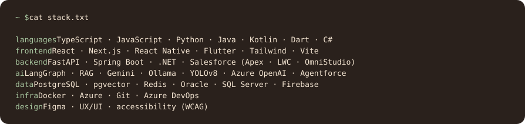

  

  

  
   
  
    <a href="https://github.com/evamyuu/anicca">anicca</a> ·
    <a href="https://github.com/evamyuu/arandu-space">arandu-space</a> ·
    <a href="https://github.com/evamyuu/metamorfose-kotlin">metamorfose</a> ·
    <a href="https://github.com/evamyuu/unisolar-api">unisolar</a> ·
    <a href="https://github.com/evamyuu/auti-web">auti</a>
  

  

  
  

  <picture>
    <source media="(prefers-color-scheme: dark)" srcset="https://raw.githubusercontent.com/evamyuu/evamyuu/output/garden-snake-dark.svg">
    
  </picture>

  
  
  

  

